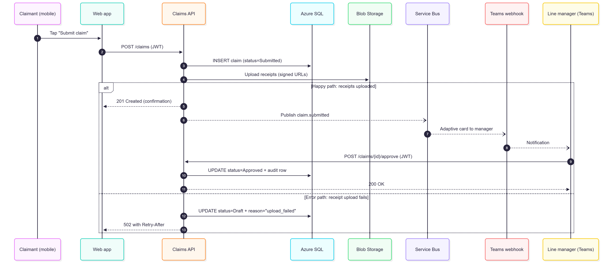
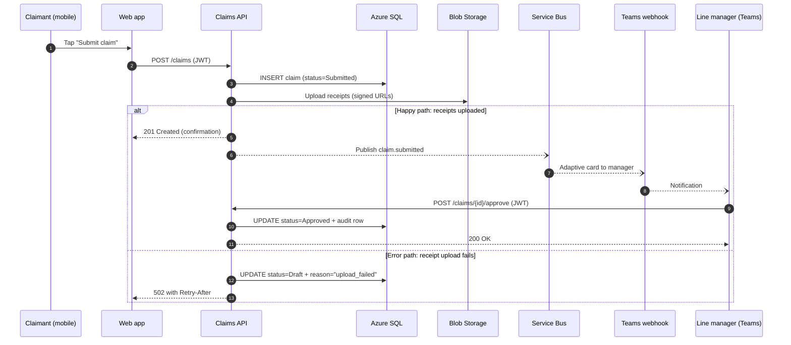

# Sequence — Submit and Approve a Claim

## Happy path and error path

## How to read it

- Solid arrows (`->>`) are synchronous. The caller waits for the reply.
- Dashed return arrows (`-->>`) are responses.
- Open-head arrows (`--)`) are asynchronous. The sender does not wait.
- The `alt` box shows two outcomes after the receipt upload: the happy path above the line, the error path below it.
